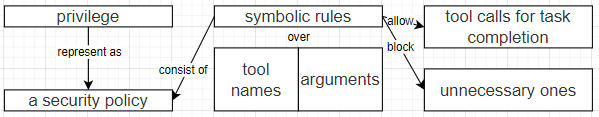
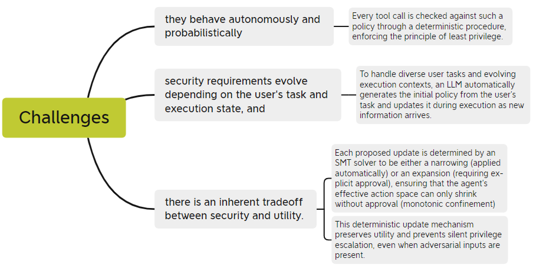

## Progent: Securing AI Agents with Privilege Control

### Abstract

**Background: **

AI agents interact with external environments through tool calls, exposing them to attacks like indirect prompt injection that can trigger unauthorized actions.

**Challenges:**

Securing these agents is challenging: 

- they behave autonomously and probabilistically, 
- security requirements evolve depending on the user’s task and execution state, and
- there is an inherent tradeoff between security and utility.

> Agents 通过工具调用可以与外部环境交互，但是这种工具调用的方式会把自己暴露在一些攻击当中，例如间接提示词注入，而这会触发非权限行为。
>
> 但是针对Agent的保护面临着一些挑战：
>
> - 这些工具调用的行为是自发的、有概率的
> - 安全需求会随着用户任务和执行状态变化
> - 这是一个内在的 安全性 与 实用性的权衡

Progent represents privilege as a security policy consisting of symbolic rules over tool names and arguments.

These rules specify which tool calls are allowed for task completion and which unnecessary ones are blocked for security.

> Progent 把 权限 作为 一个安全策略，而这个安全策略 由一些 符号规则组成，这些符号规则在 工具名称和参数之上。这些规则会明确区分 哪些工具调用是任务完成所应允许的 哪些工具调用是非必要的，并且为了保证安全应当阻塞的。

Every tool call is checked against such a policy through a deterministic procedure, enforcing the principle of least privilege.

> 每一个工具调用都会与 安全策略进行对照，这个过程用一个 确定的程序完成，使得每一个工具调用都执行这个最低权限原则。
>
> 我个人认为，这个“每一个工具调用都会与 安全策略进行对照” 设计，就是对第一个问题  “这些工具调用的行为是自发的、有概率的”的一种解决，也就是 不论工具调用何时出现，只要出现 就必须 与安全策略进行对照，一刀切 去 对抗自发性、随机性。

To handle diverse user tasks and evolving execution contexts, an LLM automatically generates the initial policy from the user’s task and updates it during execution as new information arrives.

>为了处理多个用户任务 和 不断变化的执行上下文，一个LLM根据用户任务自动的生成一个 初始策略，并且当一个新的信息到达是更新这个策略在其执行过程中。
>
>我个人认为，这个设计，是对于 问题2 “安全需求会随着用户任务和执行状态变化”的问题的一种解决，让LLM自适应的根据用户任务生成一个初始策略，然后策略的更新也是基于新信息。

Each proposed update is determined by an SMT solver to be either a narrowing (applied automatically) or an expansion (requiring explicit approval), ensuring that the agent’s effective action space can only shrink without approval (monotonic confinement)

This deterministic update mechanism preserves utility and prevents silent privilege escalation, even when adversarial inputs are present.

> 每一个被提出的更新都确定性的由SMT解算器 去区分，区分 这个更新是一个 缩小更新（自动应用）或者是一个扩展更新（要求明确的批准），这确保了Agent的有效行为空间在未经批准的条件下只能减小（单调）。这种确定性的更新机制保证了有用性，并且避免了静态权限提升，并且即使攻击信息注入情况下也能保持。
>
> 我个人认为，这个设计，是对于 问题3的解决，降低权限自动应用 保障了可用性实用性，升高权限需要明确批准 保障了安全性。

Our evaluation on popular benchmarks (i.e., AgentDojo and ASB) shows that Progent significantly reduces attack success rates while maintaining high utility. We further validate Progent’s practicality by showcasing its effectiveness in real-world agent frameworks such as LangChain and OpenAI Agents SDK.

> 这项工作在公认的基准测试上进行测试，并且Progent展现出了优秀的降低攻击成功率的能力，并且保持了高实用性。我们还评估了Progent的实用性，通过展现它在现实使用的Agent架构中的有效性，这些Agent框架 例如 LangChain 和 OpenAI Agents SDK。

