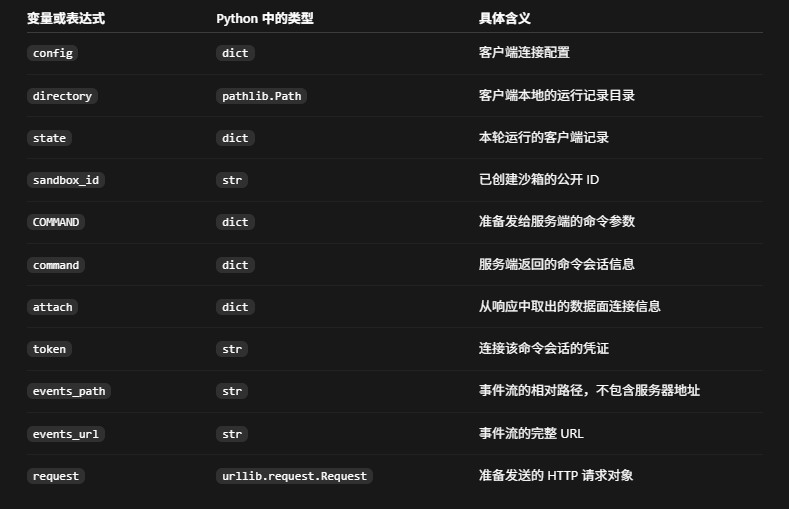

# SPACE

SPACE，全称为 Sandboxed Platform for Agentic Code Execution（面向 Agent 代码执行的沙箱平台），用于在相互隔离的 Firecracker 微型虚拟机（microVM）中运行代码。应用通过它的 HTTP API 创建 Linux 环境、执行命令、收集输出，并管理沙箱的生命周期。

当你的应用需要为 Agent、用户工作空间或代码执行任务提供独立的执行环境时，可以使用 SPACE。你的应用决定运行什么、保留哪些结果；SPACE 负责管理沙箱、其中的进程，以及传输命令输出的连接。

## 工作方式

**模板（template）** 提供初始环境。**沙箱（sandbox）** 是该环境的一个实例，拥有自己的虚拟机和可写文件系统；同一个沙箱中可以运行多条命令。

```text
你的应用
    |
    +-- 根据模板创建沙箱 ------------> 等待就绪
    |
    +-- 创建命令会话 ----------------> 连接会话，启动进程
    |                                  读取输出和退出结果
    |
    +-- 保留、暂停或挂起 ------------> 需要时唤醒
    |
    +-- 删除沙箱
    
Your application
    |
    +-- Create sandbox from template --> Wait for readiness
    |
    +-- Create command session --------> Attach to start the process
    |                                    Read output and exit result
    |
    +-- Keep, pause, or suspend --------> Wake when needed
    |
    +-- Delete sandbox
```

沙箱生命周期的变更以异步方式进行：API 返回一个操作 ID（operation ID），你需要轮询该操作以确认其完成。命令输出通过独立的数据面连接传输，并使用限定于该会话的连接令牌（attachment token）进行授权。

## 相关概念

1. 什么是沙箱Sandbox？当前的沙箱发展现状？沙箱目前大家用的版本或者产品是什么？
2. 什么是模板template？所有的沙箱都是由template实例化得到的么？template只有一种吗？
3. 什么是Firecracker？与这个类似的东西还有什么？
4. 什么是微型虚拟机（microVM）？与这个类似的东西还有什么？是否当前的Agent都是使用这个技术，如果不是 那是用的是什么？
5. 什么是 命令会话、会话 和 进程，它们的关系是什么，这个项目中类似的概念还有哪些？它们之间的关系是什么？
6. 沙箱生命周期是什么？这个项目里的API都有哪些，都有什么作用？这个项目里的ID都有哪些，都有什么作用？数据面是什么，除了这个面 这个项目里还有什么面？连接令牌是什么，这个项目里还有什么令牌？

可以。下面以“让 Agent 执行一段 Python，处理一份数据”为例，把这些概念串起来。代码均来自你本地的项目；行业产品信息按 **2026 年 10 月 23 日查阅到的官方资料**说明。

先记住这条主线：

```
Agent 决定执行什么
        ↓
SPACE 根据模板准备一个沙箱
        ↓
客户端创建命令会话
        ↓
连接数据面，启动沙箱内的进程
        ↓
接收输出和退出结果
        ↓
继续使用沙箱，或暂停、挂起、删除
```

**1. 什么是沙箱 Sandbox？目前有哪些技术和产品？**

**沙箱就是一个受到限制的执行环境：允许程序在里面做事，同时限制它能影响的范围。**

可以把它理解为实验室的操作间：程序可以在操作间里运行、读写文件，但能否访问外面的文件、网络和设备，要受规则控制。

例如 Agent 生成了：

```
import os
os.remove("/tmp/data.csv")
```

如果直接在你的电脑上执行，操作的是你电脑的文件。放在 SPACE 沙箱里执行，操作的是该沙箱里的文件。

不过，**沙箱的保护范围取决于具体实现和配置**。如果你主动把宿主机目录以可写方式共享进去，里面的程序仍可能修改那个目录。

**“沙箱”没有统一的版本，也不对应唯一产品。** 它是一类技术，主要有下面几条路线：

| 技术路线           | 通俗理解                                     | 代表实现                            |
| ------------------ | -------------------------------------------- | ----------------------------------- |
| 操作系统级进程限制 | 给程序划定能读写的目录、能访问的网络等       | bubblewrap、macOS Seatbelt          |
| 容器隔离           | 把进程、文件系统和网络等组织成相对独立的环境 | Docker、containerd                  |
| 用户态内核         | 在程序与宿主内核之间增加一层系统调用处理     | gVisor                              |
| 虚拟机隔离         | 为执行环境提供独立的客体操作系统内核         | Firecracker、Kata Containers 等方案 |
| 语言运行时隔离     | 在受控运行时中执行特定格式的代码             | WebAssembly 等                      |

这些路线现在同时存在，并不是后一种完全取代前一种。例如，gVisor 把许多系统接口放到每个沙箱独立的应用内核中处理；Kata Containers 则把轻量虚拟机接入容器生态。[gVisor 官方说明](https://gvisor.dev/docs/)、[Kata 官方介绍](https://katacontainers.io/collateral/kata-containers-overview-july22.pdf)

面向 Agent 的产品或平台，可以先认识这些：

| 平台或产品                | 提供什么                                                     |
| ------------------------- | ------------------------------------------------------------ |
| **SPACE**，你正在学的项目 | 自建沙箱平台，使用 Firecracker microVM，提供 API 和生命周期管理 |
| **E2B**                   | 面向 Agent 的隔离执行环境，提供 SDK、模板和持久化能力        |
| **Daytona**               | 提供可编程沙箱，当前文档包含容器、Linux VM 等多种环境        |
| **Docker Sandboxes**      | 面向 AI 编程 Agent 的沙箱产品，当前本地方案使用 microVM      |

这里列的是代表性方案，不是市场占有率排名。[E2B 文档](https://docs.e2b.dev/)、[Daytona 文档](https://www.daytona.io/docs/sandboxes)、[Docker Sandboxes 安全模型](https://docs.docker.com/ai/sandboxes/security/)

还要区分两个层次：

```
Firecracker：创建和控制微型虚拟机的底层工具
SPACE：利用这个工具，提供完整沙箱服务的平台
```

你的本地 SPACE workspace 声明版本为 `0.8.0`。这只是当前源码的版本，不表示另一个对话已经把它部署成功。

------

**2. 什么是模板 Template？所有沙箱都由模板实例化吗？模板只有一种吗？**

**模板是“创建执行环境时使用的初始材料和配置”。**

可以把模板理解为预装系统的母盘：

```
Python 模板
    ├── Linux 文件系统
    ├── Python
    ├── 常用依赖
    └── 默认配置
          ↓ 创建
    ┌─────┴─────┐
  沙箱 A      沙箱 B
```

A、B 最初可以很相似，但创建以后各有自己的可写文件系统。A 安装一个包、修改一个文件，不代表 B 或原模板跟着改变。

**项目里的实际例子**

项目已经包含多份模板配方。

基础模板来自 [seed.toml (line 10)](SPACE-main/templates/firecracker/recipes/seed.toml:10)：

```
[metadata]
name = "seed"
description = "Minimal Ubuntu Firecracker seed"
from = "scratch"
```

意思是：构建一个名为 `seed` 的基础环境，这个配方从基础来源开始构建。

更完整的代码执行模板来自 [code-runtime.toml (line 13)](SPACE-main/templates/firecracker/recipes/code-runtime.toml:13)：

```
[metadata]
name = "code-runtime"
description = "SPACE code runtime with Python, Node.js, Jupyter, data science, and dev tools"
base = "seed"
vcpu = 2
memory_mib = 2048
disk_size_mb = 4096
```

这表示：

- 基于 `seed` 继续构建。
- 增加 Python、Node.js、Jupyter 等工具。
- 设置默认 CPU、内存、磁盘配置。

注意：**配方文件是构建说明；构建完成并发布的模板制品，才是创建沙箱实际使用的内容。**

**SPACE 怎样选择模板？**

官方示例里的代码是：

```
body = {"template": config["template"], "runtime": "fc"}
result = mutation(
    config, directory, state,
    "create", "POST", "/v1/sandboxes", body
)
```

来源：[first_sandbox.py (line 166)](SPACE-main/examples/first_sandbox.py:166)。

这里：

- `template`：选择初始环境。
- `runtime: "fc"`：选择 Firecracker 运行时。

模板引用还可能有不同精确程度：

| 表示方式      | 含义                             |
| ------------- | -------------------------------- |
| `seed`        | 模板名称，具体解析规则由平台处理 |
| `seed:latest` | 选择某个标签指向的发布版本       |
| digest 引用   | 按内容摘要选择特定制品，便于复现 |

**是不是所有沙箱都由模板实例化？**

需要分范围：

- **对于 SPACE 的普通新建流程**：可以这样理解，客户端选择模板，平台据此创建环境。
- **对于已经挂起的 SPACE 沙箱**：恢复时可以使用保存的快照，恢复原来的运行状态，不是重新创建一个干净环境。
- **对于所有沙箱技术**：不成立。有些进程沙箱只是限制一个已有程序，并没有“模板实例化”这个步骤。

模板与快照也不同：

> 模板主要回答“从什么初始环境开始”；快照主要回答“怎样回到之前保存的状态”。

------

**3. 什么是 Firecracker？类似的东西有哪些？**

**Firecracker 是一个用来创建、运行和控制微型虚拟机的软件。**

更准确的术语是 **VMM：Virtual Machine Monitor，虚拟机监控器**。它利用 Linux 的 KVM 虚拟化能力运行 microVM，采用精简的设备模型，减少资源开销和攻击面。它最初由 AWS 开发。[Firecracker 官方仓库](https://github.com/firecracker-microvm/firecracker)

可以这样分层理解：

```
SPACE：管理沙箱、模板、命令、权限和生命周期
    ↓
Firecracker：配置并控制微型虚拟机
    ↓
KVM：Linux 内核提供的虚拟化能力
    ↓
CPU 的硬件虚拟化支持
```

**在项目中能直接看到它怎样配置虚拟机。**

沙箱启动代码生成了下面这些配置，节选自 [start.rs (line 2259)](SPACE-main/crates/libs/sbx/mgr/server/src/service/start.rs:2259)：

```
"boot-source": {{
  "kernel_image_path": "/vmlinux.bin",
  "boot_args": "{boot_args}"
}},
"drives": [{{
  "drive_id": "rootfs",
  "path_on_host": "/rootfs.ext4",
  "is_root_device": true,
  "is_read_only": false{disk_rate_limiter}
}}],
"machine-config": {{
  "vcpu_count": {vcpu},
  "mem_size_mib": {mem_mib},
  "smt": false{huge_pages}
}},
```

这是 Rust 格式化字符串中的一部分，因此使用双大括号。

它配置了：

- **kernel**：虚拟机启动的 Linux 内核。
- **rootfs**：虚拟机的根文件系统磁盘。
- **vCPU**：虚拟 CPU 数量。
- **memory**：虚拟机内存。

所以 SPACE 里的沙箱不是简单地换个目录运行 Python，而是真的有客体内核、磁盘和虚拟计算资源。

类似或相近的底层工具包括：

| 工具                 | 定位                                                        |
| -------------------- | ----------------------------------------------------------- |
| **QEMU**             | 功能广泛的虚拟化与硬件模拟工具，也提供精简的 `microvm` 机型 |
| **Cloud Hypervisor** | 面向现代云工作负载的 VMM                                    |
| **Firecracker**      | 重点面向精简、隔离的 microVM 工作负载                       |

它们处在相近层次，但功能和适用场景不完全一样。[QEMU microvm 文档](https://www.qemu.org/docs/master/system/i386/microvm.html)、[Cloud Hypervisor 官方仓库](https://github.com/cloud-hypervisor/cloud-hypervisor)

版本方面也要区分：

- 我查到 Firecracker 官方 `latest` 发布为 **v1.17.0**。[官方发布页](https://github.com/firecracker-microvm/firecracker/releases/tag/v1.17.0)
- 你本地项目的安装脚本默认使用 **v1.15.1**，代码是：

```
FC_VERSION="${SPACE_FC_VERSION:-v1.15.1}"
```

来源：[install-fc-vendor.sh (line 30)](SPACE-main/infra/space/kind/scripts/install-fc-vendor.sh:30)。

这是脚本默认值，实际安装版本还可能被环境变量覆盖。

------

**4. 什么是 microVM？Agent 都用它吗？**

**microVM 就是针对特定工作负载做了精简的虚拟机。**

它仍然是虚拟机，有自己的客体操作系统内核；“微型”主要强调虚拟硬件、启动流程和管理功能经过精简，并不是说只能运行一个小程序。

可以用下面的示意理解：

```
普通 Linux 容器：

程序 A     程序 B
  ↓          ↓
容器 A     容器 B
  └────┬─────┘
    共享宿主内核


microVM：

程序 A          程序 B
  ↓               ↓
客体内核 A      客体内核 B
  ↓               ↓
microVM A       microVM B
  └──────┬────────┘
      虚拟化层
          ↓
       宿主系统
```

这里比较的是原生 Linux 上的普通容器。Docker Desktop 本身还可能运行在虚拟机中，但不等于每个容器都有独立内核。

| 环境         | 主要特点                         | 需要考虑的代价               |
| ------------ | -------------------------------- | ---------------------------- |
| 普通进程沙箱 | 限制进程权限，开销较低           | 隔离能力依赖具体操作系统机制 |
| 普通容器     | 打包和运行方便，通常共享宿主内核 | 共享内核属于重要安全边界     |
| gVisor       | 增加用户态内核层                 | 部分兼容性和性能取舍         |
| microVM      | 独立客体内核，虚拟硬件较精简     | 需要虚拟化支持，管理更多资源 |
| 通用虚拟机   | 设备与操作系统支持更广           | 通常有更多启动和运行开销     |

**Agent 并不都用 microVM。**

Agent 的“思考和决策”与“执行工具的环境”可以分开：

```
模型服务：决定运行 python analyse.py
                    ↓ 工具请求
执行后端：在进程沙箱、容器或 microVM 中执行
```

真实产品也有不同选择：

- Claude Code 官方介绍的本地沙箱方案使用 Linux bubblewrap、macOS Seatbelt 等操作系统机制。[官方说明](https://www.anthropic.com/research/claude-code-sandboxing)
- Docker Sandboxes 当前的本地方案使用 microVM。[官方说明](https://docs.docker.com/ai/sandboxes/security/)
- Daytona 当前提供容器及虚拟机等多种沙箱。[官方文档](https://www.daytona.io/docs/sandboxes)
- SPACE 使用 Firecracker microVM。

因此，不能通过“用了某个模型”推断它的执行环境。**同一个 Agent 可以接入不同执行后端，同一种执行后端也可以服务不同 Agent。**

------

**5. 命令会话、会话和进程是什么关系？还有哪些相近概念？**

先用一个具体任务区分：

```
sandbox：为这个任务准备的一台隔离小电脑

command：我要执行 python analyse.py

process：python analyse.py 实际运行起来的程序实例

command session：保存这次执行的连接信息、授权和状态

connection：客户端此刻用于接收输出的一条连接
```

**命令是要求，进程是正在发生的执行。**

例如：

```
COMMAND = {
    "command": ["sh", "-c", 'printf "Hello from SPACE\\n"'],
    "timeout": "30s"
}
```

这是项目官方示例中的命令配置。它表达“启动 `sh`，让它执行后面的字符串，执行期限为 30 秒”。

**SPACE 的命令会话如何工作？**



```
# 从客户端的运行记录 state 中取出沙箱 ID，
# 并检查它是否是一个以 "sbx_" 开头的有效字符串。
#
# 此时沙箱已经在之前的 create_sandbox(...) 中创建并等待就绪。
sandbox_id = require_id(state, "sandbox_id", "sbx_")


# 向控制面提交命令。
#
# mutation 是项目自己定义的辅助函数，不是 Python 内置函数。
# 它会：
#   1. 记录这次修改请求的方法、路径、请求体和幂等键；
#   2. 将记录保存到客户端本地；
#   3. 调用管理 API；
#   4. 返回服务端 JSON 响应解析得到的 Python 字典。
command = mutation(
    config,       # 客户端配置：管理 API 地址、数据面地址、管理凭证等
    directory,    # 客户端本地记录目录，用来保存 state.json 等文件
    state,        # 客户端本轮运行记录，包含请求记录和各类 ID
    "command",    # 给这次请求起的本地记录名称
    "POST",       # HTTP 方法：向服务端提交创建请求

    # 管理 API 的路径。
    # f 字符串会把 sandbox_id 的实际值插入路径中。
    f"/v1/sandboxes/{sandbox_id}/commands",

    COMMAND       # 请求体：描述要执行的命令、执行超时等
)


# 从服务端返回的 command 字典中提取：
#   command["session_id"] -> state["session_id"]
#   command["process_id"] -> state["process_id"]
#
# 同时检查 ID 前缀，并把更新后的 state 保存到客户端本地。
#
# 注意：你引用的简化代码省略了这一步，
# 所以下面才会直接出现 state["session_id"]。
remember_ids(
    directory,
    state,
    command,
    [
        ("session_id", "session_id", "proc_"),
        ("process_id", "process_id", "proc_"),
    ]
)


# 从命令会话的响应中，取出连接信息。
# attach 本身也是一个字典。
attach = command["attach"]


# 根据会话 ID，构造接收事件流的路径。
#
# 注意这里使用的是 session_id，
# 因为客户端要连接的是“这个命令会话”。
events_path = f"/v1/sessions/{state['session_id']}/events"


# 数据面服务的基础地址 + 事件流路径 = 完整访问地址。
#
# 这里使用 data_plane_url，而不是管理 API 的 api_url。
events_url = config["data_plane_url"] + events_path


# 检查服务端返回的事件流地址：
# 它必须与客户端预期的路径或完整地址一致。
#
# 防止把连接令牌发送到意料之外的目标。
if attach["events_url"] not in {events_path, events_url}:
    raise ValueError(
        "Unexpected events URL; do not bypass the destination check"
    )


# 取出这次命令会话的连接令牌。
#
# 它来自服务端响应，不是 config["token"] 中的管理凭证。
token = attach["token"]


# 确认连接令牌是非空字符串。
if not isinstance(token, str) or not token:
    raise ValueError("Command attachment token is missing")


# 构造一个 HTTP 请求对象。
#
# Request 来自 Python 标准库 urllib.request。
# 这里没有提供 data，也没有显式指定 method，
# 因而默认使用 GET。
#
# 注意：这一步只是准备请求，还没有真正访问网络。
request = Request(
    events_url,

    headers={
        # HTTP 认证头。
        #
        # Bearer 是认证方案名称；
        # 后面跟的是这次命令会话的连接令牌。
        "Authorization": f"Bearer {token}",

        # 告诉服务端：
        # 我希望接收 SSE，即 text/event-stream 格式的事件流。
        "Accept": "text/event-stream",
    }
)
```

来源：[run_command (line 224)](SPACE-main/examples/first_sandbox.py:224)。

顺序是：

```
提交命令
   ↓
得到命令会话，以及预先分配的 process_id
   ↓
连接会话
   ↓
启动进程
   ↓
通过事件流读取输出和退出结果
```

**创建命令会话本身，不代表进程已经开始运行。** 创建命令时也可以请求直接返回事件流，让“创建并连接”在一次客户端请求中完成。

**“会话”是比“命令会话”更宽的概念。**

项目定义了这些数据面会话类型：

```
wire_enum_open_schema!(SessionKind, "session kind", {
    Terminal => "terminal",
    Process => "process",
    FileWatch => "file_watch",
    Port => "port",
    Protocol => "protocol",
});
```

来源：[SessionKind 定义 (line 707)](SPACE-main/crates/libs/public/api/src/lib.rs:707)。

| 会话类型  | 通俗用途                               |
| --------- | -------------------------------------- |
| Process   | 运行程序、获取输出；命令会话使用这一类 |
| Terminal  | 交互式终端，例如持续输入 shell 命令    |
| FileWatch | 监听文件变化                           |
| Port      | 连接沙箱内服务端口                     |
| Protocol  | 连接特定协议目标                       |

这些类型在代码中存在，但并非全部属于当前稳定支持范围。

还有一种同样叫 Session、却含义不同的对象：**用户登录会话**。它记录用户身份、登录令牌哈希和过期时间，与某次命令会话不是一回事。

**一个容易误解的实现细节**

在 SPACE 的命令模型中，`session_id` 和公开的 `process_id` 虽然用途不同，但目前由同一个标识派生，字符串值相同：

```
pub fn process_id_for_session(session_id: DataPlaneSessionId) -> ProcessId {
    ProcessId::parse(session_id.to_string())
        .expect("a data-plane session id is a valid process id")
}
```

来源：[process_id_for_session (line 1962)](SPACE-main/crates/libs/public/api/src/lib.rs:1962)。

代码注释解释：一个 process 类型的数据面会话对应一个 guest 进程，这样平台在进程启动之前就能为它命名。

注意：

- 公开的 `process_id` 不是 Linux 的数字 PID。
- 启动前已经能返回它，不代表此时能查询到运行中的进程。
- 进程结束以后，进程查询也可能返回找不到；进程列表不是历史执行记录。
- 一条命令启动的主进程仍可能生成子进程。

**这些对象的完整关系**

```
模板
 └── 沙箱 A
      ├── 命令会话 1 → 进程 1 → 输出与退出结果
      ├── 命令会话 2 → 进程 2 → 输出与退出结果
      └── 终端或端口等其他会话

创建、暂停、删除沙箱等动作
 └── 分别由 Operation 跟踪执行进度
```

同一个沙箱里的不同命令可以通过文件共享工作成果，但前一个进程的 Python 变量、shell 变量不会因此自动进入下一个进程。

例如：

```
命令 1：写入 /tmp/result.txt
命令 2：读取 /tmp/result.txt
```

可以共享文件；而第一次 Python 执行里的 `x = 10`，不会自动成为第二次 Python 进程的变量。

------

**6. 生命周期、API、ID、数据面和令牌分别是什么？**

这部分概念较多，分开解释。

**沙箱生命周期：这个执行环境从创建到销毁的全过程**

先抓住主要状态：

```
创建 → 运行
         ├── pause   → 暂停，内存仍留在 worker 上
         ├── suspend → 挂起，保存快照并释放活跃 VM 资源
         ├── stop    → 停止，不等于保存运行快照
         └── delete  → 删除
```

| 动作                  | 通俗理解               | 对运行状态的含义                           |
| --------------------- | ---------------------- | ------------------------------------------ |
| `create`              | 准备一台新的隔离小电脑 | 从模板准备新环境                           |
| `pause` / `resume`    | 冻结 / 继续            | 保留驻留内存，不是持久快照                 |
| `suspend` / `restore` | 保存现场 / 恢复现场    | 保存 VM 内存、运行状态和根文件系统快照     |
| `stop` / `start`      | 停机 / 再启动          | 不应假设会保留进程内存现场                 |
| `wake`                | 把它变回可运行状态     | 根据当前状态选择适用的启动、继续或恢复路径 |
| `delete`              | 销毁环境               | 该沙箱不再可通过 API 使用                  |

项目实际调用 Firecracker 暂停、继续的代码很直观：

```
/// Pause the VM (freeze vCPUs).
pub async fn pause(&self) -> Result<(), FcApiError> {
    self.patch_vm("Paused").await
}

/// Resume the VM (thaw vCPUs).
pub async fn resume(&self) -> Result<(), FcApiError> {
    self.patch_vm("Resumed").await
}
```

来源：[fc_api.rs (line 105)](SPACE-main/crates/libs/node/runtime/core/src/fc_api.rs:105)。

这也解释了为什么 **pause 不等于 suspend**：前者冻结执行，后者还要进行快照持久化等操作。

此外，SPACE 的 E2B 兼容层命名不同：

```
ECW 的 pause  → SPACE 的 suspend
ECW 的 resume → SPACE 的 restore
```

读文档时要看清调用的是哪套 API。

**Operation：异步动作的进度单**

创建虚拟机需要时间，HTTP 请求不宜一直等待所有步骤完成。因此 API 先返回：

```
sandbox_id：创建的是哪个沙箱
operation_id：跟踪哪次创建动作
```

官方示例接着做了三层检查：

```
wait_for_state(
    config, f"/v1/operations/{state['operation_id']}", "succeeded"
)
wait_for_state(
    config, f"/v1/sandboxes/{state['sandbox_id']}", "running"
)
ready = api(
    config, "GET",
    f"/v1/sandboxes/{state['sandbox_id']}/processes?limit=1",
    timeout=180
)
```

来源：[create_sandbox (line 166)](SPACE-main/examples/first_sandbox.py:166)。

分别确认：

1. 创建操作成功。
2. 沙箱处于运行状态。
3. 进程服务可以访问。

因此，下面三个“成功”不能混为一谈：

```
请求被接受 ≠ 环境已就绪 ≠ 程序执行成功
```

程序成功还要看退出事件。项目示例检查的是：

```
if kind == "process_exited":
    code = frame.get("exit_code")
    if type(code) is not int or code != 0:
        raise RuntimeError(f"Command did not exit successfully: {code!r}")
    completed = True
```

来源：[consume_events (line 205)](SPACE-main/examples/first_sandbox.py:205)。

打印了输出，甚至 HTTP 返回成功，都不能代替退出结果。

**项目有哪些 API？**

API 就是软件提供给其他程序调用的入口。例如：

```
POST /v1/sandboxes
```

可以读作：“请创建一个沙箱。”

当前文档明确列出 **14 个受支持的 HTTP 操作**。下表中用 `S` 表示 `/v1/sandboxes/{sandbox_id}`：

| 方法   | 路径                               | 用途                       |
| ------ | ---------------------------------- | -------------------------- |
| POST   | `/v1/sandboxes`                    | 创建沙箱                   |
| GET    | `/v1/sandboxes`                    | 列出沙箱                   |
| GET    | `S`                                | 查询一个沙箱               |
| DELETE | `S`                                | 删除沙箱                   |
| POST   | `S:pause`                          | 暂停                       |
| POST   | `S:suspend`                        | 挂起并保存状态             |
| POST   | `S:wake`                           | 唤醒                       |
| POST   | `S/commands`                       | 创建命令会话               |
| GET    | `S/processes`                      | 列出运行中的进程           |
| GET    | `S/processes/{process_id}`         | 查询进程                   |
| POST   | `S/processes/{process_id}:kill`    | 终止进程                   |
| POST   | `S/processes/{process_id}:signal`  | 向进程发送信号             |
| GET    | `/v1/operations/{operation_id}`    | 查询异步操作               |
| GET    | `/v1/sessions/{session_id}/events` | 连接数据面，获取命令事件流 |

其中最后一项由**数据面服务**承接，其余这些操作属于控制面入口。

源码还包含下面这些**孵化中接口**，部分默认隐藏：

| 接口组         | 路径或动作                                                   | 作用                           |
| -------------- | ------------------------------------------------------------ | ------------------------------ |
| 沙箱配置       | `PATCH S`、`S:set_timeout`                                   | 修改配置、超时策略             |
| 其他生命周期   | `:start`、`:stop`、`:resume`、`:restore`、`:kill`            | 显式控制运行状态               |
| 快照           | `/snapshots`、`/snapshots/{snapshot_id}`、`:checkpoint`、`:rollback`、`:enable_snapshots`、`:disable_snapshots` | 查询和控制快照、检查点、回滚   |
| 文件           | `S/files:list`、`:read`、`:write`、`:write_batch`、`:mkdir`、`:remove`、`:rename`、`:stat` | 文件与目录操作                 |
| 文件变化       | `S/files:changes_enable`、`:changes_disable`、`:modified`    | 跟踪文件变化                   |
| 创建其他会话   | `S/terminal-sessions`、`/process-sessions`、`/file-watch-sessions`、`/port-sessions`、`/protocol-sessions` | 终端、进程、文件监听和服务连接 |
| 会话管理       | `S/sessions`、`S/sessions/{session_id}`                      | 列出、查询、撤销会话           |
| 端口           | `S/ports`、`S/ports/{port}/open`、`/close`                   | 管理服务端口暴露               |
| 网络           | `S/network-policy`                                           | 查询网络策略                   |
| 状态与观测     | `S/stats`、`S/metrics-stream`、`S/lifecycle-events`、操作的 `/events` | 统计、指标和事件               |
| 模板           | `/v1/templates`、`/v1/templates/{template_name}`             | 列出与查询模板                 |
| 凭证引用       | `/v1/credential-references` 及其单项路径                     | 注册、删除凭证引用             |
| 其他数据面连接 | `/v1/sessions/{session_id}/attach`、`/proxy`                 | 交互连接与代理                 |

这些状态由源码直接声明，例如：

```
CREATE_COMMAND = NativeOperation::new(
    "/v1/sandboxes/{sandbox_id}/commands",
    Post, "createCommand", M1Supported
);

CREATE_TERMINAL_SESSION = NativeOperation::new(
    "/v1/sandboxes/{sandbox_id}/terminal-sessions",
    Post, "createTerminalSession", Incubating
);
```

来源：[原生 API 路由清单 (line 187)](SPACE-main/crates/libs/public/api/src/routes.rs:187)。

这里的 `M1Supported`、`Incubating` 是支持状态。**源码里有接口，不表示当前部署一定启用，也不表示接口约定已经稳定。**

除此以外，项目还有：

- **ECW API**：兼容 E2B 客户端的接口。
- **管理接口**：管理用户、组织、节点、模板构建等。
- **内部 gRPC 接口**：供 SPACE 各服务协作使用。
- **健康检查接口**：例如 `/healthz`、`/readyz`。

学习调用流程时，先掌握上面的 14 个受支持操作即可。完整定义可查 `/openapi-m1.json`；孵化中及隐藏接口分别通过项目文档说明的 OpenAPI 入口查看。

**项目有哪些 ID？**

**ID 是对象的编号，用于指出“你在操作谁”。**

主要公开 ID 的前缀在代码中直接定义：

```
pub const PUBLIC_SANDBOX_ID_PREFIX: &str = "sbx_";
pub const PUBLIC_OPERATION_ID_PREFIX: &str = "op_";
pub const PUBLIC_SNAPSHOT_ID_PREFIX: &str = "snap_";
pub const TERMINAL_SESSION_ID_PREFIX: &str = "term_";
pub const PROCESS_SESSION_ID_PREFIX: &str = "proc_";
pub const FILE_WATCH_SESSION_ID_PREFIX: &str = "watch_";
pub const PORT_SESSION_ID_PREFIX: &str = "port_";
pub const PROTOCOL_SESSION_ID_PREFIX: &str = "proto_";
```

来源：[公开 ID 定义 (line 29)](SPACE-main/crates/libs/public/api/src/lib.rs:29)。

| ID                          | 用途                                                |
| --------------------------- | --------------------------------------------------- |
| `sandbox_id`，`sbx_…`       | 指向一个执行环境                                    |
| `operation_id`，`op_…`      | 指向一次异步生命周期操作                            |
| `session_id`                | 指向一次数据面会话；前缀体现类型                    |
| `process_id`                | 指向一个进程；命令流程中使用 `proc_…`，不是数字 PID |
| `snapshot_id`，`snap_…`     | 指向保存的快照                                      |
| 模板 ID、名称、标签、digest | 分别用于识别模板对象、选择发布版本、确定具体内容    |
| `user_id`、`org_id`         | 识别用户和组织，参与归属及权限判断                  |
| `node_id`、集群 ID          | 识别承载服务的节点和集群                            |
| API key ID、凭证引用 ID     | 识别凭证记录或引用，不等于秘密本身                  |
| `request_id`                | 跟踪一次 HTTP 请求，便于排障                        |
| 作业、激活尝试等内部 ID     | 跟踪后台工作、重试和执行归属                        |

还有一个容易混淆的值：**`Idempotency-Key`，幂等键**。

它主要表达“这是同一次修改请求的重试”，用于减少网络异常导致的重复创建或重复执行；它不是沙箱编号，也不是认证令牌。

**数据面是什么？还有什么“面”？**

“面”可以理解为按职责划分的一组服务和通信路径。

项目在公开 API 代码里明确区分：

```
pub enum NativeSurface {
    ControlPlane,
    DataPlane,
}
```

来源：[NativeSurface (line 65)](SPACE-main/crates/libs/public/api/src/routes.rs:65)。

| 划分                     | 通俗理解               | SPACE 中的工作                                      |
| ------------------------ | ---------------------- | --------------------------------------------------- |
| **控制面 Control Plane** | 管理和调度             | 验证权限、记录期望状态、创建和管理沙箱、协调 worker |
| **数据面 Data Plane**    | 承载执行交互的数据通道 | 连接客户端和 guest 进程，转发输出、输入及服务流量   |

例如：

```
控制面：
客户端 → 创建沙箱 → API → 数据库、控制器与 worker

数据面：
客户端 ← 输出、退出事件 ← 数据面 ← 沙箱内进程
```

**真正执行程序的是沙箱内的进程，数据面负责连接和转发。**

项目还有 worker 执行服务、网络网关、模板构建与存储、可观测性组件。这些也能按职责讨论，但不需要把每一组都硬称为一个独立的“面”。

尤其要分清两种网络路径：

```
客户端获取命令输出：客户端 ↔ 数据面 ↔ guest 进程

沙箱访问外部网站：guest → 网络网关 → 外部服务
```

获取输出与控制出站网络权限，是不同职责。

**连接令牌是什么？还有哪些令牌？**

**连接令牌 Attachment Token 是“允许你连接某个会话的临时通行证”。**

如果把 `session_id` 比作房间号，那么连接令牌就是进入这个房间所需的通行凭证。

```
ID：你要连接哪个会话？
Token：你是否有权连接？
```

项目会随机生成数据面令牌：

```
fn new() -> Self {
    let mut bytes = [0u8; 32];
    rand::fill(&mut bytes);
    let raw = format!("{DATA_PLANE_TOKEN_PREFIX}{}", hex::encode(bytes));
    let hash = hash_token(&raw);
    Self { raw, hash }
}
```

同一文件定义：

```
const DEFAULT_ATTACH_TOKEN_TTL: Duration = Duration::from_secs(5 * 60);
const DATA_PLANE_TOKEN_PREFIX: &str = "dpt_";
```

来源：[public_sessions.rs (line 26)](SPACE-main/crates/libs/api/src/public_sessions.rs:26)。

这说明该实现使用随机令牌，保存对应哈希，并设置默认过期时间。不能把所有令牌都理解为 JWT；这里这个令牌就是带前缀的随机字符串。

项目中主要需要区分这些凭证：

| 凭证                                       | 谁使用               | 主要用途                           |
| ------------------------------------------ | -------------------- | ---------------------------------- |
| 用户登录会话令牌                           | 登录用户、管理客户端 | 证明用户身份，访问管理 API         |
| 服务 API key / 服务凭证                    | 自动化应用           | 按允许的 API 范围和权限调用服务    |
| 数据面连接令牌 `dpt_…`                     | 命令客户端           | 连接特定数据面会话                 |
| ECW API key                                | E2B 兼容客户端       | 通过 `X-API-Key` 调用 ECW 管理接口 |
| ECW `envd_access_token`                    | E2B 兼容客户端       | 访问兼容层的沙箱操作路径           |
| ECW `traffic_access_token`                 | 对应服务访问客户端   | 访问沙箱服务流量路径               |
| 内部 bearer 令牌或 Kubernetes 服务身份令牌 | SPACE 内部服务       | 服务之间的认证                     |
| 对象存储临时凭证中的 session token         | 存储客户端、内部服务 | 访问获准的模板或快照存储资源       |

内部令牌相关配置包括：

```
pub const SPACE_INTERNAL_TOKEN_ENV: &str = "SPACE_INTERNAL_TOKEN";
pub const SPACE_INTERNAL_CONTROL_TOKEN_ENV: &str = "SPACE_INTERNAL_CONTROL_TOKEN";
```

来源：[bearer-token 库 (line 26)](SPACE-main/crates/libs/bearer-token/src/lib.rs:26)。具体部署也可能使用投射并轮换的 Kubernetes 令牌，而不是静态环境变量。

最后，令牌的有效期、会话的有效期、命令的执行超时、沙箱的生命周期是**四件不同的事**。最小执行流程只需先记住两种权限：

```
管理凭证：创建和管理环境、提交命令
连接令牌：连接这一次命令会话、接收执行数据
```

两者不能互换；知道某个沙箱或会话的 ID，也不等于拥有操作它的权限。


