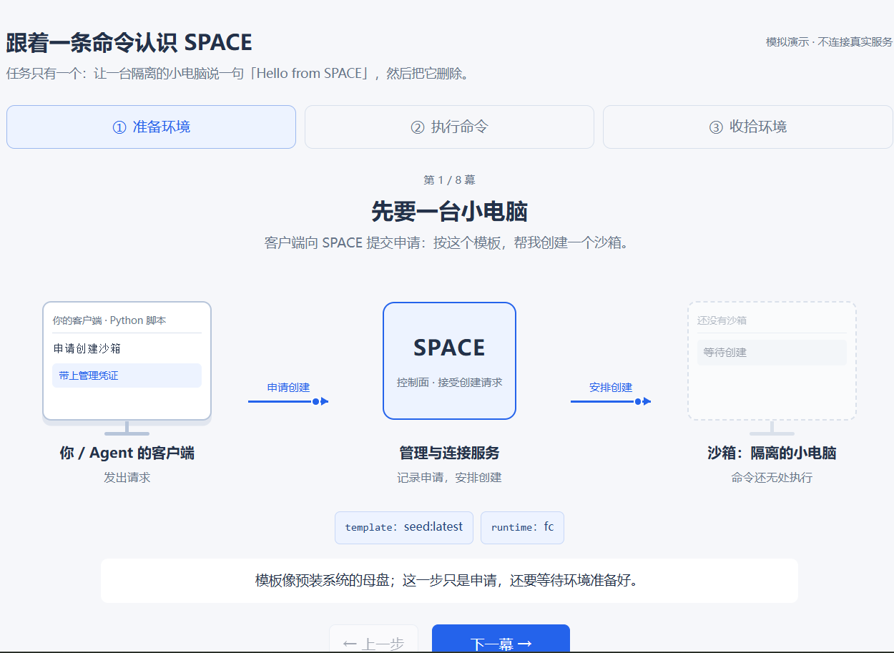
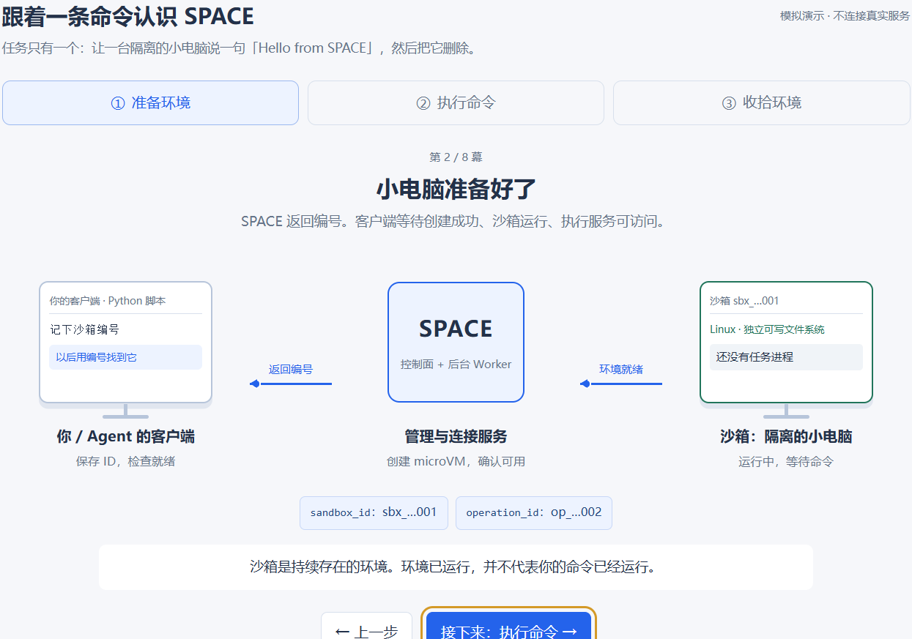
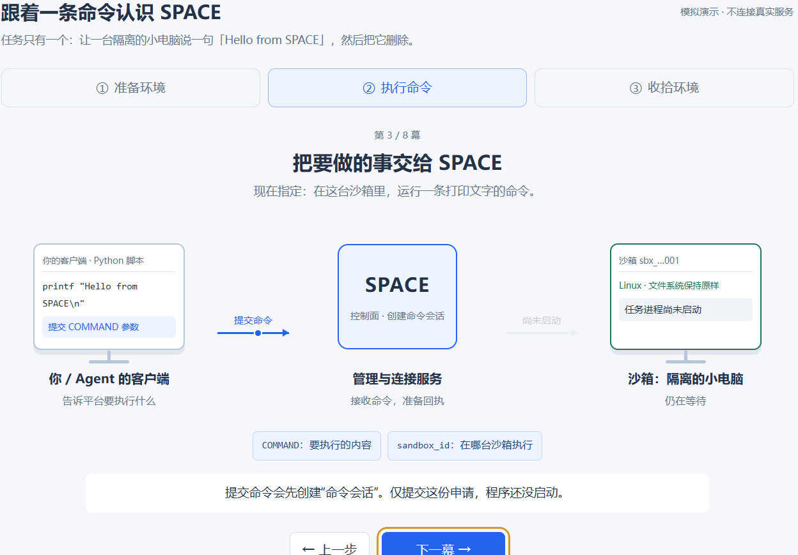
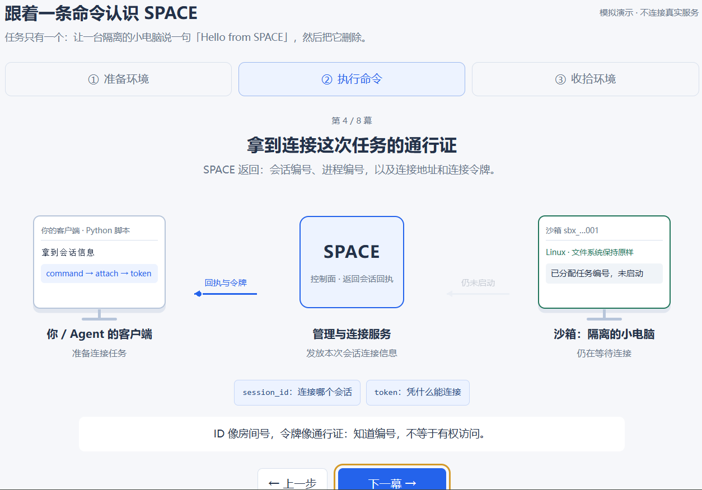
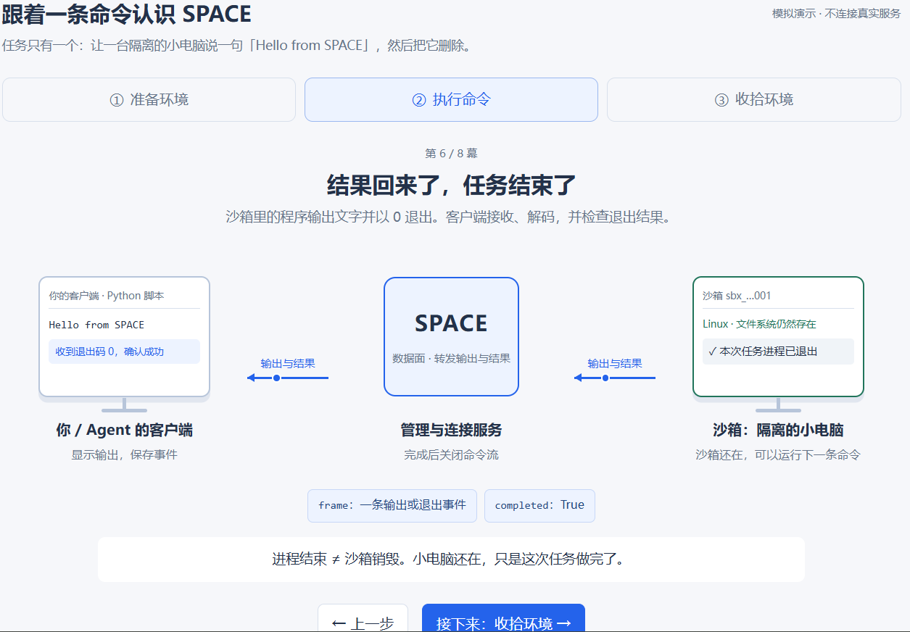
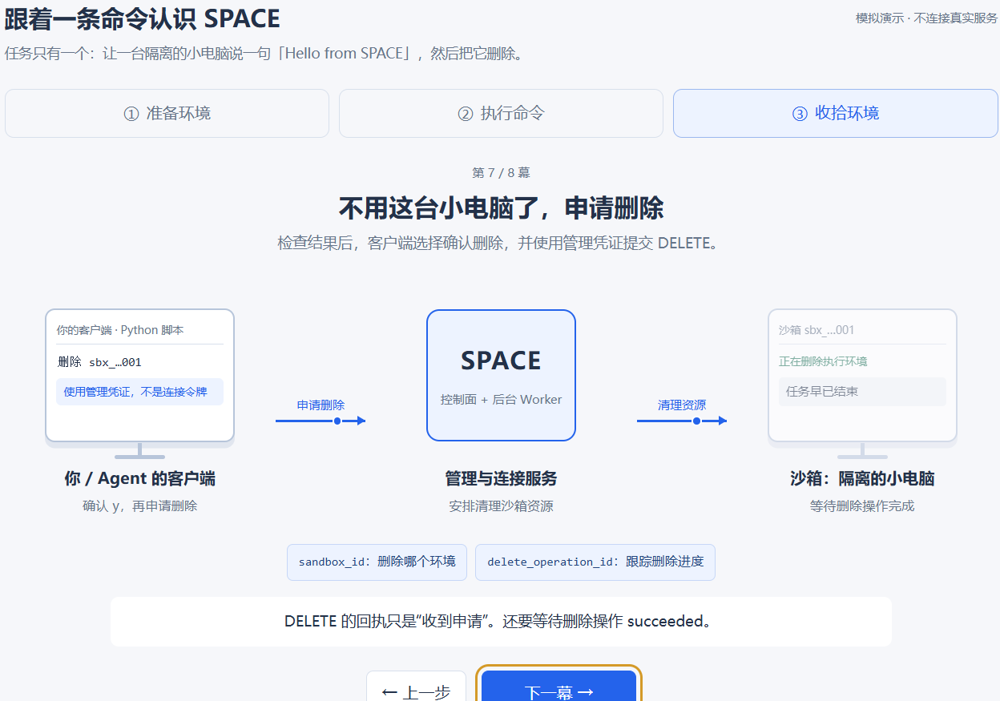
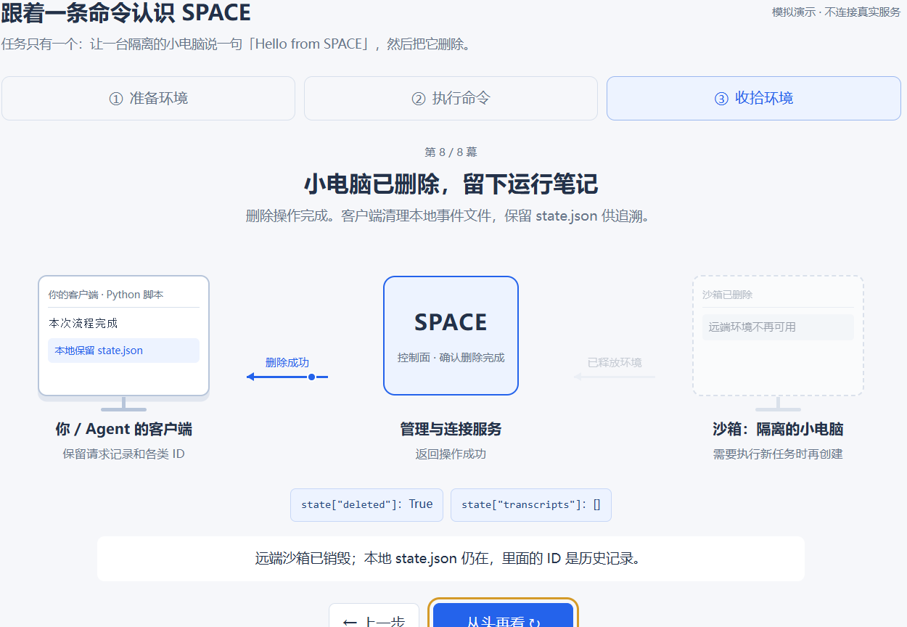

# 以可视化角度从first_sandbox.py理解SPACE的工作流程

第一步 客户端向SPACE提交申请，按照template ，创建一个sandbox。这个过程中，主要有四个重要的变量：

- config：是客户端的通讯录，去哪里连接，用什么凭证都是其内部参数刻画。
- body：是创建申请单，告诉SPACE要创建哪种环境。
- directory：客户端把运行笔记存在这个文件夹里，不会发送给SPACE。
- state：客户端自己的运行笔记，用于记住请求、编号和事件文件。

第二步，sandbox准备好后，SPACE会把sandbox id等参数传给客户端，客户端收到后会记下沙箱编号，以后就用这个沙箱编号去找沙箱。这个过程中，有五个重要的变量：

- result：是SPACE的创建回执，会告诉客户端 环境编号（sandbox id）和申请编号（operation id），其中 sandbox id以后用来指定操作哪台sandbox；operation id用它询问创建申请是否完成。
- sandbox_id：就是前面提到的 sandbox id，这是这台隔离小电脑的编号。
- state["operation_id"]：创建申请的查询号，用来追踪创建进度。
- ready：客户端试着访问执行服务，确认它已经能回应。
- state：客户端自己的运行笔记：记住请求、编号和事件文件。

第三步，客户端把需要做的事情发送给SPACE，在这个过程中，客户端告诉平台需要做什么，提交COMMAND参数，然后SPACE收到命令，准备回执，也就是控制面创建命令会话。此时sandbox任务进程还没有启动。这里面涉及的主要的变量如下：

- sandbox_id：这个是客户端发给SPACE的，是为了指定哪台小电脑执行接下来的命令。
- COMMAND：这个是客户端发给SPACE的，具体要求sandbox要做的事情，运行什么程序、给什么参数，最多跑多久。
- state["request"] [name]：是客户端发送给本地state.json的，但是 其中的body/key是要给api()发出的，作用是 客户端先存一张申请副本，避免断网以后自己提交过什么。
- config：是客户端的通讯录，连接什么，用什么凭证。主要包括 api_url管理请求寄到哪里，data_plane_yrl命令输出通道连到哪里，token证明客户端有权管理沙箱的凭证，template告诉平台按照哪份初始环境创建沙箱。

第四步，SPACE的控制面返回会话回执给客户端，客户端拿到会话信息，这个过程中SPACE返回的主要是会话编号、进程编号，以及连接地址和连接令牌，然后客户端就开始准备连接任务，sandbox已分配任务编号，但是仍未启动，此时的sandbox等待连接。主要有以下变量：

- command：是控制面发到客户端的。其中包含 session_id表示连接哪一次会话，process_id 用来表示查询或控制这次命令对应的进程，sandbox_id, attach把连接地址、通行证和有效期装到一起。
- state["session_id"]：是这次连接的房间号，用来找命令会话。
- state["process_id"]：是这次任务的公开进程编号。
- attach：这一包连接信息，告诉客户端“往哪连、凭什么去连”。
- token：这次命令会话的通行证，连接数据面时要出示。

第五步，客户端带着连接令牌打开数据通道。SPACE 经后端启动沙箱里的程序。Agent真正发送GET连接请求，到达SPACE，数据面验证并连接，然后SPACE转发执行数据到sandbox，sandbox执行打印命令。主要变量如下：

- events_path：只写门牌、不写主机地址的会话入口。
- events_url：把服务器地址和会话入口拼在一起，得到完整连接地址。
- request：客户端准备好的信封：地址和通行证都放好了，但还没寄出。
- token：这次命令会话的通行证，连接数据面时要出示。
- response：这个是 数据面发送给客户端的。服务端打开的一条回信通道，客户端可以不断从中读消息。
- transcript：客户端一边收消息，一边把原始内容记到这个本地文件。

第六步，沙箱里的程序输出文字并以 0 退出。客户端接收、解码，并检查退出结果。沙箱执行完成后，将输出和结果发送到SPACE，SPACE通过数据面转发输出与结果，完成后关闭命令流，客户端收到输出与结构后显示输出，并且保存该事件。主要变量如下：

- frame：从网络消息里拆出来的一条事件：可能是输出，也可能是退出结果。
- stdout/ stderr/ output：把普通输出放到终端，把诊断信息放到错误输出通道。
- completed：客户端记下：我已经看到程序正常退出的明确证据。
- transcript：客户端一边收消息，一边把原始内容记到这个本地文件。

第七步，准备申请删除sandbox，检查结果后，客户端选择确认删除，并使用管理凭证提交 DELETE。客户端使用管理凭证，不是连接令牌申请删除，提交到SPACE安排清理沙箱资源，sandbox开始删除环境。主要变量如下：

- sandbox_id：这台隔离小电脑的编号。
- result：SPACE 的删除回执，给你一个号，稍后用它查删完了没有。是控制面发给客户端的。
- state["delete_opration_id"] / operation_id：拿着删除查询号，问 SPACE：这台小电脑删完了吗？
- config：客户端的通讯录：去哪里连接，用什么凭证。
- state["requests"] [name]：客户端先存一张申请副本，避免断网后忘了自己提交过什么。

第八步，删除操作完成。客户端清理本地事件文件，保留 state.json 供追溯。sandbox已经被删除，SPACE控制面确认删除完成，返回操作成功，客户端本地保留state.json。下面是主要变量：

- state["delete_opration_id"] / operation_id：拿着删除查询号，问 SPACE：这台小电脑删完了吗？
- state["deleted"]：客户端笔记上盖一个章：已确认远端删除成功。
- state["transcripts"] / name：按本地笔记里的名单，删除本轮保存的事件文件。
- directory：客户端把运行笔记存在这个文件夹。
- state：客户端自己的运行笔记：记住请求、编号和事件文件。

