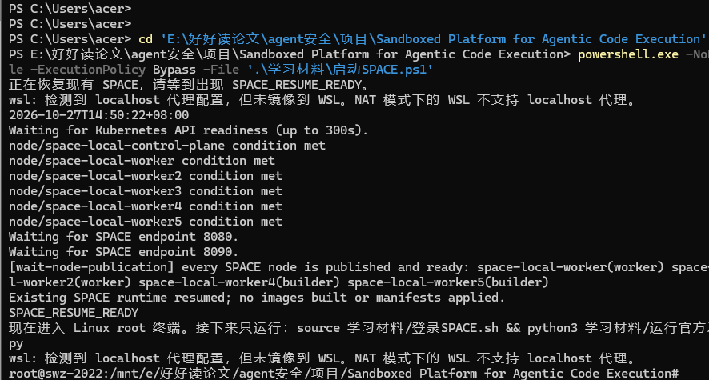
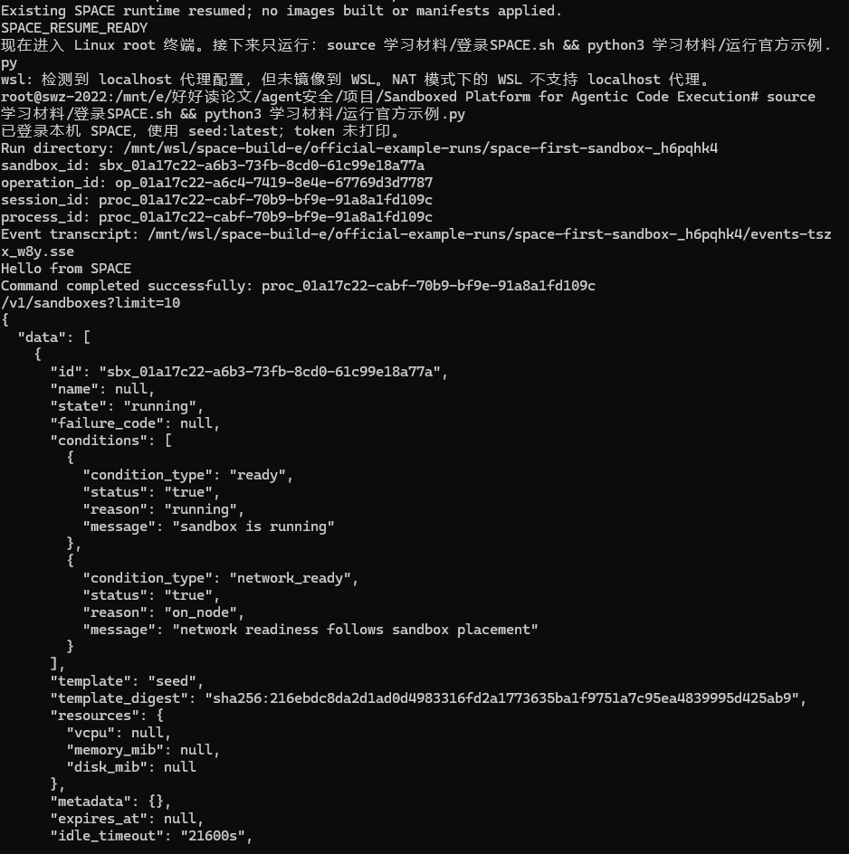
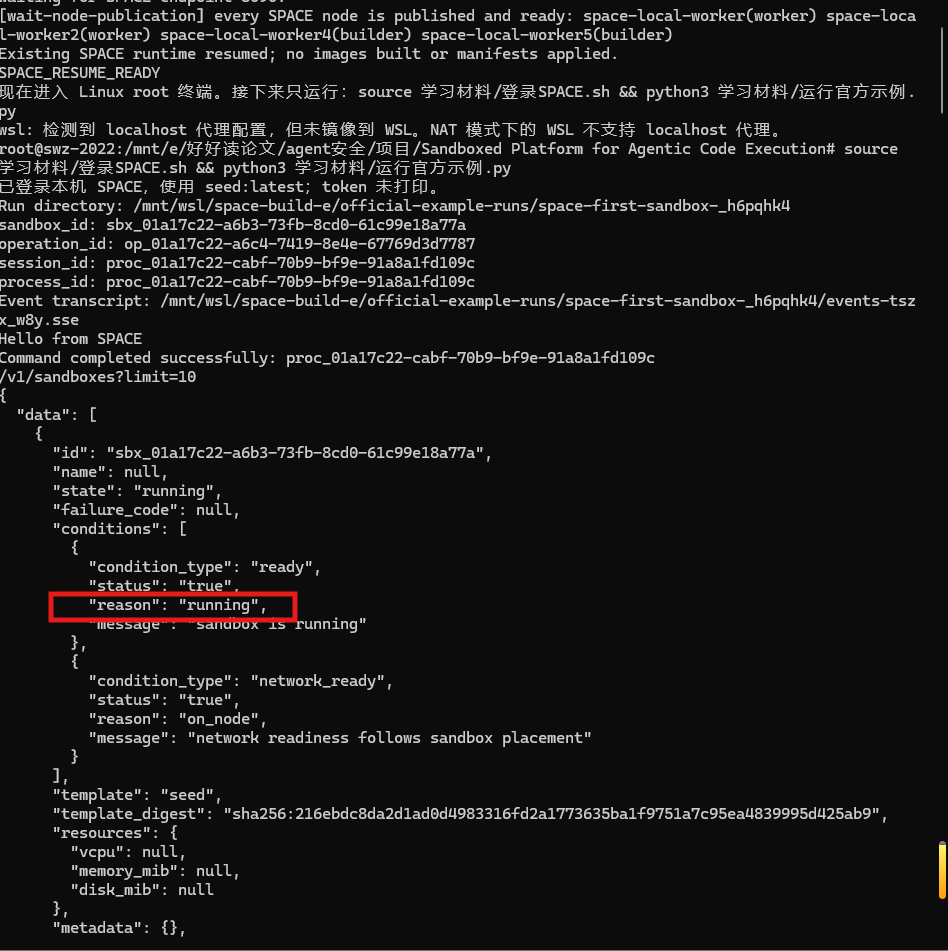
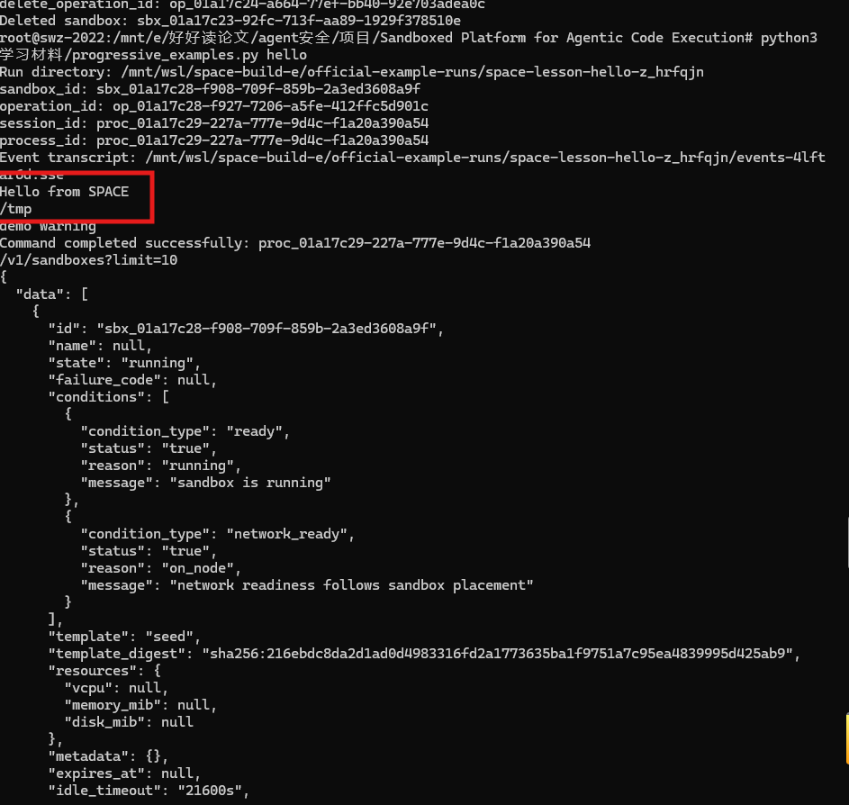
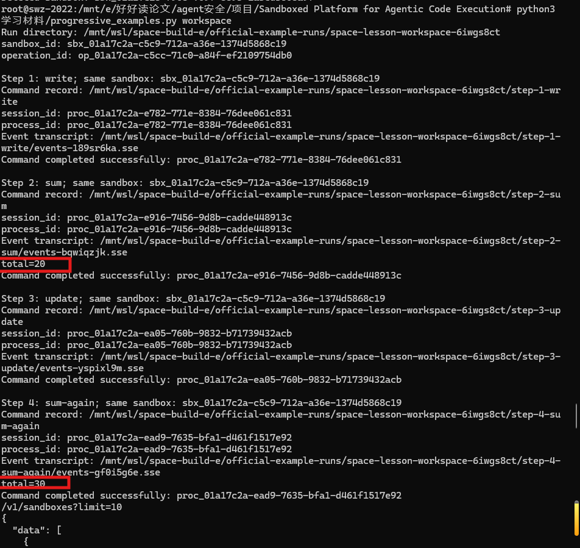
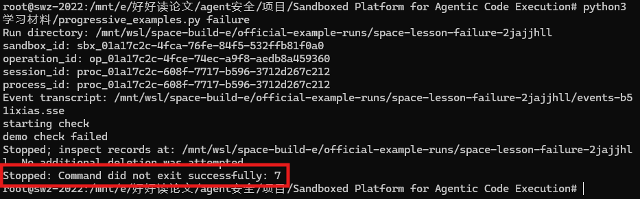

# 实际运行SPACE

**先做一次官方例子，再按 create → hello → workspace → failure 学。每次只看当前例子涉及的函数。**

## 1. 启动或恢复平台，并进入 root

**每次重启 Windows/WSL 后，先恢复数据卷和服务。** 如果目前看到 `acer@...$`，先输入 `exit` 回到 Windows PowerShell；然后运行：

```powershell
cd 'E:\好好读论文\agent安全\项目\Sandboxed Platform for Agentic Code Execution'
powershell.exe -NoProfile -ExecutionPolicy Bypass -File '.\学习材料\启动SPACE.ps1'
```



启动脚本会挂载并核对原 E 数据卷、恢复原有服务，再明确使用 `root --exec /bin/bash` 进入项目目录。需要挂载时 Windows 会弹出管理员授权窗口。等到 `SPACE_RESUME_READY` 后进入 Linux 终端，`whoami` 应输出 `root`。

冷启动时会先显示 `Waiting for Kubernetes API readiness (up to 300s).`，等待 Kubernetes 接口就绪后再检查节点。短暂的连接重置或 `Forbidden: unknown` 会在这一阶段重试；超过等待时间仍未就绪才报错，不能仅凭 `Forbidden` 就判断账号权限损坏。

本机已切换 WSL NAT 模式，以规避 mirrored 模式下观察到的网络锁死。若看到 `NAT 模式下的 WSL 不支持 localhost 代理`，这是 Windows 代理未继承的提示；本地 SPACE 示例直连回环地址。判断启动是否完成仍看 `SPACE_RESUME_READY`。若提示 `WSL network query is stuck`，说明网络查询卡住，启动会停止，不能继续当作健康平台使用。

这是日常学习用的恢复入口：复用已部署镜像，不启动 Tilt 的构建监听。需要修改 SPACE 平台源码并重新部署时，才使用官方开发启动流程。

需要网页控制台时，在另一个 root 终端运行 `kubectl --context kind-space-local -n space port-forward --address=127.0.0.1 svc/space-ui 3000:3000`，保持该终端开启，再访问 `http://127.0.0.1:3000`。

**看到 `root@...#` 就已经在 Linux 中，不要再粘贴 PowerShell 的 `& ...wsl.exe` 命令。** 接下来在这个 root Linux 终端运行：

```bash
source 学习材料/登录SPACE.sh && python3 学习材料/运行官方示例.py
```



登录脚本设置本机 API、数据平面、`seed:latest` 和 E 盘记录目录；token 只保留在终端环境中。`&&` 保证登录失败时不会继续运行示例。已经进入 root 并登录后，同一终端可以直接运行后面的课程。

`运行官方示例.py` 只在入口检查是否已有活动沙箱，随后执行未修改的官方 `first_sandbox.py`；不是模拟实现。若已有运行中或创建未完成的沙箱，会打印 ID 和状态并拒绝再次新建。四个递进课程也使用同一检查。本检查用于本机单人顺序学习，不是服务端并发锁。

`/mnt/e/…` 的项目文件夹可见，并不代表 `/mnt/wsl/space-build-e` 的独立 Linux 数据卷已经挂载；出现卷未挂载时重新运行启动入口。`/root/SPACE` 由 root 访问，普通用户的 `Permission denied` 也不代表源码丢失。

看到 `Hello from SPACE` 和 `Command completed successfully` 后，在删除提示处输入 `y`。这会等待删除操作成功，并清理该次命令的客户端事件文件。

本机 WSL 仅有约 6 GiB 内存，练习应逐台完成并清理。选择 `N` 会保留 VM；再次运行示例会创建另一台 VM，不会继续上一台。出现创建超时后，先使用输出中的原目录运行 `python3 /root/SPACE/examples/first_sandbox.py inspect 原目录`，不要连续重跑。`SPACE_RESUME_READY` 表示平台服务恢复，并不表示还能容纳任意数量的新 VM。

## 2. 四个递进练习

配套脚本：[progressive_examples.py](progressive_examples.py)。它直接导入实际部署的 `/root/SPACE/examples/first_sandbox.py`，调用官方函数。下面四课都请求真实平台、创建真实 VM；不需要大模型 API。

### demo1 只创建和删除

```bash
python3 学习材料/progressive_examples.py create
```

观察 `sandbox_id`、`operation_id`，以及查询结果里的 `state: running`。本课不提交任务命令，最后输入 `y` 删除。

只读官方文件中的：`create_sandbox()` → `mutation()` / `api()` → `wait_for_state()` → `inspect_run()` → `delete_sandbox()`。

要理解：创建请求返回 ID 之后，后台仍要完成工作。**请求被接受、创建操作成功、guest 进程接口就绪，是不同阶段。** 官方 `create_sandbox()` 已依次等待。




### demo2 命令、环境变量、工作目录和输出

```bash
python3 学习材料/progressive_examples.py hello
```

实际命令设置了 `GREETING` 和 `cwd=/tmp`，并分别写 stdout、stderr。应看到：

```text
Hello from SPACE
/tmp
demo warning
Command completed successfully: proc_...
```



只增加阅读：`run_command()` → `event_frames()` → `consume_events()`。

`run_command()` 先向管理 API 创建 command session，取得进程 ID 和 attachment token，再连接数据平面的事件地址。**attach 才触发执行。** 管理 token 和这次会话的 attachment token 用途不同。

`consume_events()` 将 `data_base64` 解码为输出，并检查 `process_exited.exit_code`。本课虽然写了 stderr，但退出码为 0，因此成功。

### demo3 同一沙箱连续执行四条命令

```bash
python3 学习材料/progressive_examples.py workspace
```

四步分别是：写入 `12 8` → 求和 → 改成 `12 18` → 再求和。实际输出包括：

```text
Step 2: sum; same sandbox: sbx_...
total=20
Step 4: sum-again; same sandbox: sbx_...
total=30
```



观察四步使用**同一个 sandbox ID**，但各有独立的 process ID 和命令幂等键。读教学文件的 `command_record()`，再对照官方 `mutation()`、`save()`、`run_command()`。

要理解：一次命令结束后，VM 内文件仍可被下一次命令使用。客户端的 `state.json` / `.sse` 在记录目录里；`/tmp/space-study/numbers.txt` 在 guest 内。它们是两个位置。删除沙箱会结束这份 guest 工作环境。

### demo4 故意失败

```bash
python3 学习材料/progressive_examples.py failure
```



guest 命令先打印 `starting check`，再向 stderr 写 `demo check failed`，最后 `exit 7`。官方事件处理函数报告：

```text
Stopped: Command did not exit successfully: 7
```


